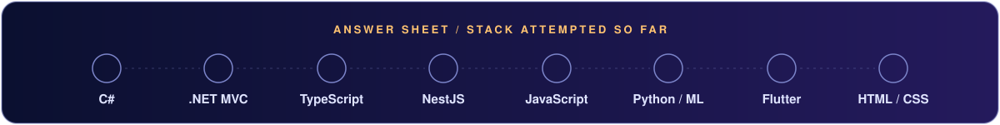

  

  

  

<b>Pop quiz:</b> how many dependencies do the quiz sites need?

 

**Zero.** Each one is a single `index.html` — no build step, no backend, no tracking. Your answers stay in your browser.

Found a wrong answer? Open an issue on that quiz's repo. Someone else is revising from the same question.

 

**[sanam-maharjan.com.np](https://sanam-maharjan.com.np)** · Good luck with the real exam.

