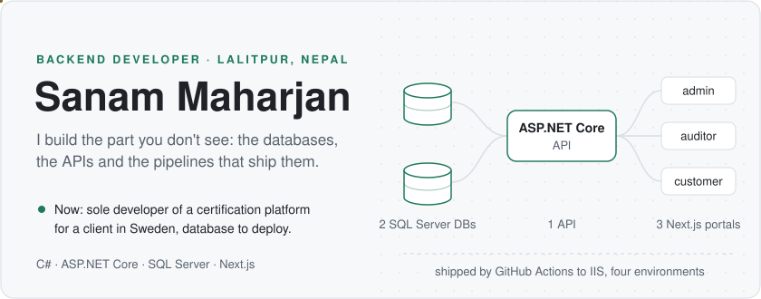
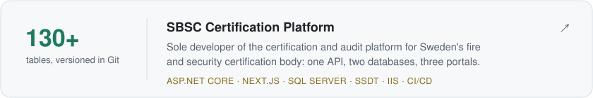
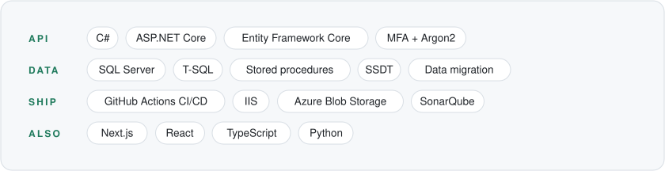

<a href="https://sanam-maharjan.com.np"><picture><source media="(prefers-color-scheme: dark)" srcset="img/hero-dark.svg"></picture></a>

### Selected work

<a href="https://sbsc.se"><picture><source media="(prefers-color-scheme: dark)" srcset="img/sbsc-dark.svg"></picture></a>
<a href="https://tulipshrm.com"><picture><source media="(prefers-color-scheme: dark)" srcset="img/hrm-dark.svg"></picture></a>
<a href="https://onemoresecure.se"><picture><source media="(prefers-color-scheme: dark)" srcset="img/oms-dark.svg"></picture></a>

### Toolbox

<picture><source media="(prefers-color-scheme: dark)" srcset="img/stack-dark.svg"></picture>

### On the side

- **Free exam practice for Nepal.** Single-file MCQ sites I keep for my own revision and anyone else's: [NEC Computer Engineering](https://newamacha.github.io/nec-mcq-practice/) · [MBA entrance](https://newamacha.github.io/mba-entrance-practice/) · [IOE M.Sc. Structural](https://newamacha.github.io/msc-structural-mcq-practice/) · [mixed exam quiz](https://newamacha.github.io/exam-practice-quiz/)
- **Research.** [Sentiment detection](https://github.com/newamacha/Sentiment-detection) for code-mixed Nepali-English product reviews, presented at ICT-CEEL 2023.

[Portfolio](https://sanam-maharjan.com.np) · [LinkedIn](https://www.linkedin.com/in/sanammaharjan007)

